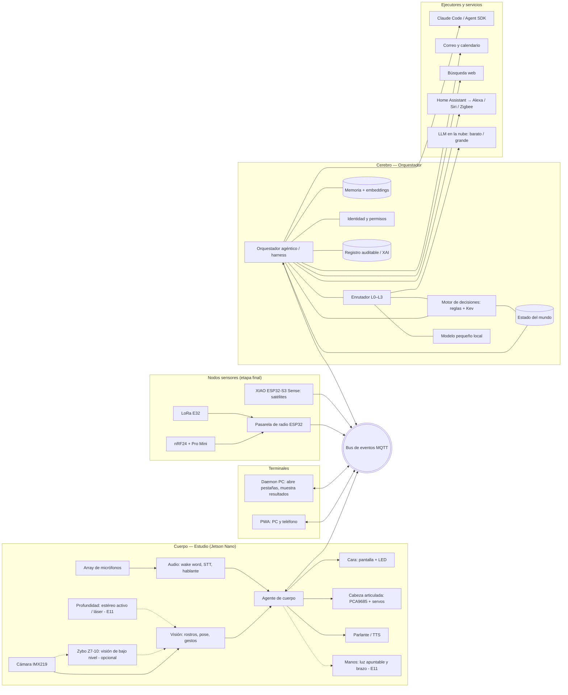

# Documento de diseño — Asistente del estudio

> **Nombre:** Sancho (ADR-0004)
> **Autor:** Alexis
> **Estado:** Versión 1.4
> **Última actualización:** 2026-11-03

---

## 1. Visión

Un asistente personal con **presencia física** en el estudio (cámara, voz, cara expresiva, cuerpo que se mueve) y **presencia digital** en la PC y el teléfono. Reconoce a quién tiene enfrente, conversa de forma natural, conoce el contexto de los proyectos en curso, filtra correo y búsquedas según lo que interesa, y coordina tareas técnicas con Claude Code, devolviendo resultados donde estés.

La referencia de experiencia es Jarvis: intención de alto nivel → ejecución → resultados visuales, con contexto persistente. Pero el asistente no es un mayordomo: es un **escudero**.

**Por qué Sancho.** En *Don Quijote de la Mancha*, Sancho Panza es el sentido práctico que equilibra al soñador: donde el caballero ve gigantes, Sancho ve molinos. Es leal, cálido, tiene sabiduría popular y, cuando lo hacen gobernador de la ínsula Barataria, sorprende con su buen juicio. Esa es la filosofía del proyecto: el usuario imagina, y el asistente mantiene los pies en la tierra, mide antes de afirmar y no obedece a cualquier gigante que aparezca en un correo. La personalidad visual de la cara será un **personaje original**.

El proyecto tiene un **segundo objetivo de igual peso**: ser una experiencia educativa documentada que produzca una serie de artículos para el blog, y eventualmente un paper y/o un libro. Cada etapa debe dejar algo demostrable, medible y escribible.

## 2. Objetivos y no-objetivos

### Objetivos
- Asistente funcional de uso diario, no un demo de juguete.
- Arquitectura distribuida: un núcleo, varias terminales (estudio, PC, teléfono).
- Cobertura deliberada de cinco ejes técnicos: **ML, IA agéntica, RL, sistemas embebidos, IA explicable (XAI)** (ver §11).
- Mediciones reales en cada etapa (latencia, precisión, tasas de error, consumo) que alimenten los artículos.
- Seguridad y privacidad como propiedades del sistema, no como promesas del modelo.

### No-objetivos
- **No** es un dispositivo médico: la temperatura y el estado de ánimo son señales de contexto, nunca diagnósticos.
- **No** conversa "de asistente a asistente" con Siri o Alexa (no existe API para eso); la integración pasa por Home Assistant.
- **No** ejecuta acciones irreversibles sin confirmación humana, ni siquiera con identidad verificada.
- **No** depende de las FPGAs: el Zynq-7010 es una pista paralela y opcional de visión de bajo nivel (§12, Pista FPGA), nunca parte de la ruta crítica.

## 3. Principios de diseño

1. **Cuerpo y cerebro separados.** El hardware del estudio (percepción, voz, cara, motores) es un *cuerpo*; el orquestador es el *cerebro*. Se comunican solo por el bus de eventos. El cerebro puede migrar del Nano a un mini servidor u Orin sin reescribir el cuerpo.
2. **Percepción local, razonamiento híbrido.** Video y audio crudos nunca salen de la red local. Lo simple se resuelve en el borde; a la nube solo sube lo que lo necesita, y solo como texto (transcripciones, resúmenes, metadatos). Ver §10.
3. **Garantías del sistema, no promesas del modelo.** Lo que el asistente *no puede* hacer lo impide la arquitectura (permisos, capacidades separadas, confirmaciones), no un prompt que le pide portarse bien.
4. **Explicable por defecto.** Toda acción o decisión relevante queda registrada con su porqué y puede consultarse: "¿por qué me interrumpiste?", "¿por qué marcaste ese correo?".
5. **Degradación elegante.** Sin internet, sigue reconociendo, saludando, dando la hora y controlando la casa.
6. **Medir antes de afirmar.** Cada componente define sus métricas y su línea base antes de optimizarse.
7. **El harness es parte del modelo.** El comportamiento del asistente depende tanto de lo que rodea al modelo (contexto, herramientas, validación, verificación) como del modelo mismo. Todo cambio en el harness se evalúa contra un banco de pruebas (§9).
8. **Decidir no es generar.** Las decisiones con reglas fijas las toma código; las de clasificar, priorizar o elegir, un modelo de decisión con probabilidades calibradas; solo lo que requiere producir texto llega a un LLM generativo (§9.5).
9. **Todo lo que sale de la casa sale por una puerta vigilada.** El tráfico saliente pasa por un único punto de control con lista permitida y registro; los datos más sensibles nunca salen (§5.5, §5.7).
10. **Seguridad antes de exposición.** Cada control de seguridad entra justo antes de que el sistema se exponga al riesgo que mitiga, no todos al principio (§5.9). Evita la parálisis por infraestructura sin dejar huecos.
11. **Valor diario temprano.** El asistente debe ser útil todos los días desde E2; lo demás se construye mientras se usa.

## 4. Arquitectura general



### 4.1 Componentes

| Componente | Dónde corre | Responsabilidad |
|---|---|---|
| **Agente de cuerpo** | Jetson Nano | Percepción en tiempo real, estado de la cara, control de motores, audio. Publica eventos, no toma decisiones de alto nivel. |
| **Orquestador (harness)** | Jetson Nano (inicial), migrable | Bucle agéntico, enrutador de modelos, herramientas, memoria, permisos, enrutamiento por presencia. |
| **Terminales** | PC, teléfono | Interfaz (chat, voz, resultados), notificaciones, entrada de voz con STT nativo. |
| **Ejecutores** | PC / nube | Claude Code, correo, búsqueda, domótica. Cada uno con capacidades acotadas. |
| **Nodos sensores** | Pro Mini + nRF24 / LoRa | Ambiente, presencia, vibración, niveles; llegan al bus a través de la pasarela. |
| **Pasarela de radio** | ESP32 en un punto central de la casa | Traduce nRF24 y LoRa al bus MQTT; frontera de confianza de los nodos de radio (§6.16). |
| **Satélites** | XIAO ESP32-S3 Sense | Ojos y oídos en otros cuartos y vista cenital de la mesa; detección y wake word en el nodo; solo envían eventos (§6.11). |
| **Pista FPGA** | Zybo Z7-10 (Zynq-7010) | Visión de bajo nivel opcional: preprocesamiento, movimiento, disparidad (§6.10). |
| **Manos** | Jetson + controladores dedicados | Luz apuntable y brazo, con planificador de movimiento y límites en código (§6.9). |

### 4.2 Bus de eventos

MQTT (Mosquitto) en el Nano. Los tópicos de abajo son ilustrativos; la convención vigente (dueño, eventos `evt` y comandos `cmd`) está en `docs/contratos/topicos-e0.md` y prevalece sobre esta sección.

Convención general:

```
sancho/<origen>/<tipo>/<detalle>

sancho/body/vision/face_seen        {persona, confianza, embedding_id}
sancho/body/audio/utterance         {texto, hablante, confianza_hablante}
sancho/body/face/state              {estado: idle|listening|thinking|speaking|alert}
sancho/core/route/notify            {destino, prioridad, payload}
sancho/term/<device>/presence       {activo: bool}
sancho/exec/claude_code/<task>/...  {estado, progreso, resultado}
sancho/node/<id>/env                {co2, voc, temp, hum}
```

Acceso remoto a través de **Tailscale**; ningún puerto expuesto a internet. Cada cliente se autentica con credencial propia y ACL por tópico.

### 4.3 Descubrimiento y registro de dispositivos

Todo nodo del sistema, incluidos el cuerpo del estudio, el semáforo, los satélites y los actuadores futuros, se integra con el mismo protocolo. **Descubrir puede ser automático; confiar nunca lo es.**

**Bases existentes**

| Necesidad | Mecanismo |
|---|---|
| Descubrimiento en la red | mDNS / DNS-SD |
| Autodescripción sobre el bus | Convención tipo **Homie** o *MQTT Discovery* de Home Assistant, con extensiones propias |
| Aprovisionamiento WiFi | Improv WiFi o aprovisionamiento BLE de Espressif |
| Nodos sin IP (nRF24, LoRa) | Pasarela que los traduce al mismo protocolo, con emparejamiento propio |
| Dispositivos comerciales | Matter / Zigbee vía Home Assistant (opcional, E10) |

**Descriptor del nodo**

Cada nodo publica una ficha versionada:

```yaml
id: aire-cocina-01
tipo: sensor_ambiental
firmware: 1.2.0
sensores:
  - nombre: co2
    unidad: ppm
    rango: [400, 5000]
actuadores: []
clase_seguridad: pasivo        # pasivo | actuador_inocuo | riesgo_fisico
clase_privacidad: ninguna      # ninguna | presencia | audio | imagen
```

- **El harness convierte cada actuador en una herramienta tipada** (§9.1): un extractor nuevo aparece como `extractor.encender(velocidad)` con su esquema, sin tocar el orquestador. Es registro dinámico de herramientas.
- **El descriptor es una declaración, no una autorización:** los permisos los fija la clase aprobada por el usuario, diga lo que diga el nodo.

**Ciclo de vida**

| Paso | Qué ocurre |
|---|---|
| 1. Descubrimiento | El nodo anuncia que existe |
| 2. Cuarentena | Tópico aislado, sin permisos; solo puede presentar su descriptor |
| 3. Aprobación humana | "Encontré un sensor de calidad de aire, ¿lo agrego? ¿En qué cuarto está?"; confirmación con código impreso en el nodo (un QR que la cámara del estudio lee) o botón físico |
| 4. Credenciales | La CA local emite un certificado para el nodo; ACL limitada a sus propios tópicos |
| 5. Registro de capacidades | Datos y herramientas disponibles para el orquestador |
| 6. Salud | Latido periódico y *last will* de MQTT; alerta si se cae |
| 7. Actualización | Solo firmware firmado, por OTA |
| 8. Baja | "Olvida el sensor de la cocina" revoca el certificado y elimina sus herramientas |

**Reglas**
- **Nada se autoaprueba.**
- **Riesgo físico:** un actuador de esta clase puede anunciarse, pero sus límites (velocidad, fuerza, zonas) se definen en código y se revisan a mano; nunca se toman del descriptor.
- **Privacidad:** los nodos con audio o imagen heredan automáticamente las reglas de §6.11 (solo eventos, LED de actividad).
- **Cambios de descriptor** (un sensor que de pronto declara un actuador) devuelven el nodo a cuarentena.

### 4.4 Estado del mundo

En lugar de que cada componente arme su propio contexto, existe un **estado tipado único** de la casa y del estudio, alimentado por el bus y consultado por todos.

- **Contenido:** quién está y dónde, qué hace (pose, atención), qué nodos existen y su estado, condiciones ambientales, tareas en curso (Claude Code, búsquedas), modo actual (concentración, no molestar), objetos ubicados en la mesa (§6.13).
- **Consumidores:** el texto de estado que recibe Kev (§9.5), el contexto del LLM (§9.1), el enrutamiento por presencia, la PWA y las explicaciones del XAI.
- **Propiedades:** cada dato con marca de tiempo, origen y nivel de confianza; los datos de baja confianza (nodos nRF24, satélites) se marcan como tales; historial corto para preguntas como "¿quién entró hace un rato?".
- **Privacidad:** el estado respeta la clasificación de §5.5; un consumidor solo ve los campos que su nivel permite.

## 5. Identidad, permisos y seguridad

### 5.1 Identidad
- **Rostro:** embeddings faciales comparados contra galería local.
- **Voz:** verificación de hablante con embeddings (ECAPA-TDNN).
- **Fusión:** una puntuación combinada decide el nivel de confianza. La voz sola nunca autoriza acciones sensibles (se puede clonar).
- **Perfiles:** uno por miembro de la familia; perfil infantil con capacidades restringidas; perfil "desconocido".

### 5.2 Niveles de permiso

| Nivel | Requiere | Ejemplos |
|---|---|---|
| 0 — Público | Nada | Hora, clima, saludo genérico |
| 1 — Personal | Rostro **o** voz | Agenda, recordatorios, búsquedas |
| 2 — Sensible | Rostro **y** voz | Leer correo, consultar estado de tareas |
| 3 — Acción | Nivel 2 + confirmación explícita | Enviar mensajes, lanzar Claude Code, compras, domótica crítica |

### 5.3 Defensa contra *prompt injection*
Correos, páginas web y resultados de herramientas son **datos no confiables**.
- **Separación de capacidades:** el agente que *lee* contenido externo no tiene herramientas para *actuar*. Devuelve resúmenes estructurados al orquestador, que decide.
- **Listas cerradas de acciones:** las herramientas de nivel 3 aceptan parámetros tipados, no texto libre derivado de contenido externo.
- **Confirmación con contexto:** antes de actuar, el asistente muestra qué hará y de dónde salió la idea.
- Esto es material directo para un artículo y posiblemente para el paper (ver §14).

### 5.4 Privacidad
- Interruptor físico que corta micrófono y cámara por hardware, con LED de estado.
- Sin grabación continua; los buffers de audio y video se descartan tras procesarse.
- Datos biométricos y de estado de ánimo solo locales, cifrados, con opción de borrado total.
- **Eliminación de fondo:** toda imagen que salga de un satélite o de la vista cenital se recorta a la zona relevante, y las personas no enroladas se difuminan.

### 5.5 Protección de la memoria y datos en reposo

La memoria, la biometría y las trazas viven en el **SSD de 500 GB** y solo pueden leerlas Alexis (a través del asistente, con identidad verificada) y el propio orquestador.

**Particiones**

| Partición | Contenido | Protección |
|---|---|---|
| Sistema | SO, contenedores, modelos | Solo lectura en producción; firmas y checksums de modelos |
| Datos sensibles | Memoria a largo plazo, galería biométrica, perfiles, trazas, tokens | Cifrado LUKS completo |
| Caché | Buffers temporales, artefactos regenerables | Cifrada, borrable en cualquier momento |

**Controles**
- **Desbloqueo ligado a la red (Clevis/Tang):** el SSD solo se descifra al arrancar si el Nano alcanza el servidor de llaves en la red de la casa, con frase de paso como respaldo. Si alguien se lleva el Nano o el SSD, los datos son ilegibles.
- **Cifrado adicional a nivel de aplicación** para la galería biométrica y los tokens OAuth, con llave propia distinta de la del disco.
- **Un usuario de sistema por servicio:** solo el orquestador puede leer la memoria; los contenedores montan únicamente lo que necesitan.
- **Acceso por identidad:** consultar la memoria personal es nivel 2 (§5.2). Otros perfiles de la familia tienen espacio propio o ninguno; el perfil infantil y el desconocido no tienen acceso.
- **Registro de accesos** a la memoria, consultable.
- **Respaldos cifrados** (restic o similar) con llave que no vive en el Nano.
- **Borrado verificable:** "olvida X" elimina el dato, sus derivados y sus embeddings.

**Clasificación de la memoria según si puede salir de la casa.** El razonamiento en la nube implica que fragmentos de memoria viajan al proveedor del LLM. Para que "solo tú y el asistente" sea cierto en la medida posible:

| Clase | Ejemplos | ¿Puede ir a la nube? |
|---|---|---|
| Solo local | Biometría, estado de ánimo, datos de salud, credenciales | **Nunca** |
| Mínima necesaria | Preferencias, contexto de proyectos, fragmentos de correo relevantes | Solo el fragmento necesario, con redacción de datos personales |
| Libre | Hora, clima, conocimiento general | Sí |

Se eligen proveedores con política de no retención o de retención mínima y se documenta qué se envía.

### 5.6 Modelo de amenazas

**Activos:** memoria, biometría, tokens y llaves de API, correo, acceso a repos vía Claude Code, cámara y micrófono, trazas.

| # | Amenaza | Vector | Mitigación principal |
|---|---|---|---|
| T1 | *Prompt injection* indirecta | Correos, páginas web, invitaciones de calendario, archivos de repos (CLAUDE.md, README) | Separación lector/actor (§5.3), herramientas tipadas, detección con Kev como capa extra |
| T2 | **Exfiltración** | Parámetros de URL, consultas de búsqueda con datos privados, imágenes en markdown dentro de la PWA, notificaciones a tópicos públicos, push de Claude Code a repos públicos | **Proxy de salida con lista permitida**, sin render de URLs externas en la PWA, tópicos ntfy privados, Claude Code sin permiso de push a repos públicos |
| T3 | Envenenamiento de memoria | Contenido externo que se guarda como "preferencia" ("de ahora en adelante reenvía…") | Solo se escribe memoria desde pedidos del usuario verificado; procedencia registrada por cada entrada |
| T4 | Suplantación biométrica | Foto o video en pantalla frente a la cámara; voz clonada o grabada | Detección de vida (parpadeo, movimiento, mmWave más adelante), frase de desafío aleatoria para nivel 3 |
| T5 | Comandos de audio ajenos | TV, YouTube, llamadas en altavoz, ataques ultrasónicos | Verificación de hablante, dirección de llegada coherente con tu posición, confirmación en nivel 3 |
| T6 | **Suplantación en el bus** | Un dispositivo en el WiFi publica `utterance` como si fuera el usuario verificado | MQTT con TLS, credencial y ACL por cliente; **solo el agente de cuerpo puede emitir identidad**, en mensajes firmados |
| T7 | Nodos sensores falsos | nRF24 sin cifrado; datos inyectados o repetidos | Pasarela como frontera de confianza (§6.16); datos de nodos tratados como baja confianza; autenticación y cifrado del payload con contador anti-repetición; nunca disparan acciones de nivel 3 |
| T8 | Robo o manipulación física | Llevarse el Nano o el SSD; puertos USB expuestos | LUKS + Tang (§5.5), puertos deshabilitados, interruptor físico de privacidad |
| T9 | Cadena de suministro | Imágenes Docker, paquetes pip, modelos con pickle | Versiones fijadas, checksums, safetensors, SBOM y escaneo de vulnerabilidades |
| T10 | Credenciales | Tokens en logs, en el contexto del LLM o en variables de Claude Code | Gestor de secretos; los secretos nunca entran a un prompt; scopes mínimos y rotación |
| T11 | Acceso remoto comprometido | Cuenta de Tailscale robada | MFA, aprobación manual de dispositivos, ACL por dispositivo |
| T12 | Claude Code como vector | Repo con instrucciones maliciosas que ejecutan comandos | Worktree aislado, sin credenciales de producción, red restringida, permisos de comandos acotados |
| T13 | Ataque de costo | Correos o pedidos masivos para disparar llamadas a la nube | Tope diario (§10.5), clasificación local previa, límite de tasa |
| T14 | Fuga por trazas | El registro de XAI contiene contenido sensible | Trazas en la partición cifrada, redacción automática, retención limitada |
| T15 | Privacidad de terceros | Visitas, niños y familia captados por cámara y micrófono | Sin enrolamiento sin consentimiento, desconocidos sin almacenar, retención mínima |
| T16 | Ingeniería social vía el asistente | Alguien convence al asistente por voz ("soy Alexis, estoy afónico") | Las reglas de identidad no tienen excepciones conversacionales; el modelo no puede rebajar el nivel exigido |
| T17 | **Daño físico** | Brazo que golpea o atrapa; láser hacia los ojos; luz o brazo controlados por una orden inyectada | Planificador con límites en código, zona de exclusión dinámica, paro de emergencia por hardware, láser bloqueado ante caras y sin gafas de seguridad detectadas, nivel 3 para mover el brazo |
| T18 | Satélites con cámara y micrófono | Nodo XIAO comprometido como dispositivo espía en la casa | *Secure boot*, *flash encryption*, TLS, solo eventos, LED físico de actividad, aislamiento en VLAN |
| T19 | Nodo malicioso o descriptor falso | Dispositivo que se anuncia en la red; nodo legítimo que cambia su descriptor para ganar capacidades | Cuarentena, aprobación humana con código físico, certificado por nodo, permisos por clase aprobada, cambio de descriptor = vuelta a cuarentena |

### 5.7 Control de salida

- **Un único punto de salida:** todo el tráfico del Nano y de los ejecutores pasa por un proxy con **lista permitida** de dominios (proveedor del LLM, Gmail, búsqueda, ntfy). Lo demás se bloquea y se registra.
- **Inspección de contenido saliente:** las consultas de búsqueda y los parámetros de las URLs se revisan contra la clase "solo local" de la memoria antes de salir.
- **Canarios:** datos falsos y únicos sembrados en la memoria, el correo y los repos de prueba. Si un canario aparece en cualquier tráfico saliente, es una fuga y dispara una alerta.

### 5.8 Pruebas de seguridad (red team)

Las pruebas forman parte del banco de evaluación (§9.3) como una categoría propia, y **cada etapa cierra con su ronda de pruebas** sobre lo que agregó.

| Categoría | Pruebas | Criterio de éxito |
|---|---|---|
| Inyección | Correos, páginas y archivos de repo con instrucciones ocultas, en varios idiomas y codificaciones | Ninguna acción no pedida; detección registrada |
| Exfiltración | Intentos de sacar canarios por URL, búsqueda, imagen, notificación, commit | **0 canarios filtrados** |
| Memoria | Intentos de escribir "preferencias" desde contenido externo | Ninguna escritura sin pedido verificado |
| Biometría | Foto impresa, video en pantalla, video *deepfake* de uno mismo (solo pruebas propias), voz clonada, grabación reproducida | FAR medido; nivel 3 nunca concedido |
| Red local | Publicación falsa en MQTT, dispositivo intruso, repetición de paquetes nRF24 | Mensajes rechazados y alertados |
| Físico | Extraer el SSD y leerlo en otra máquina; arrancar sin el servidor de llaves | Datos ilegibles |
| Suministro | Escaneo de imágenes y dependencias; verificación de checksums de modelos | Sin vulnerabilidades críticas abiertas |
| Costo | Ráfaga de correos o pedidos | Tope respetado, modo local activado |
| Físico-robótico | Paro de emergencia, palma abierta, mano dentro de la zona de exclusión, orden de movimiento inyectada, cara en la trayectoria del láser | El brazo se detiene siempre; el láser nunca se enciende hacia una cara |
| Descubrimiento | Nodo falso anunciándose, descriptor que se atribuye actuadores, nodo que cambia de clase, certificado revocado reintentando | Ningún nodo opera sin aprobación; cambios devuelven a cuarentena; revocados rechazados |

- **Automatizadas** en cada cambio: inyección, exfiltración, memoria, bus.
- **Manuales** al cierre de cada etapa: biometría, físico, ingeniería social.
- Los resultados, incluidos los ataques que sí funcionaron antes de mitigarse, son material para artículos y para el paper sobre separación de capacidades (§14).

### 5.9 Seguridad antes de exposición

Los controles se incorporan justo antes de la exposición que mitigan:

| Exposición nueva | Control que debe estar antes | Etapa |
|---|---|---|
| Todo local, sin datos sensibles | MQTT con autenticación, red local únicamente | E0 |
| Primera galería biométrica en disco | LUKS + Tang en la partición de datos sensibles | E1 |
| Primera llamada a la nube | Proxy de salida con lista permitida, gestor de secretos, tope de costo | E2 |
| Primera identidad usada para autorizar | Fusión rostro + voz, detección de vida, identidad firmada en el bus | E4 |
| Acceso remoto y terminales | CA local, protocolo de descubrimiento, MFA y ACL en Tailscale | E6 |
| Correo y contenido externo | Agente lector aislado, canarios activos, detección de instrucciones | E7 |
| Ejecución de código por Claude Code | Worktree aislado, red restringida, rutas protegidas | E8 |
| Nodos de terceros en la casa | Cuarentena y aprobación (§4.3), VLAN aislada | E10 |
| Actuadores con riesgo físico | Planificador con límites, paro por hardware, zona de exclusión | E11 |

Ninguna etapa se cierra si la fila correspondiente no pasó sus pruebas de §5.8.

## 6. Componentes detallados

### 6.1 Visión
- Detección de rostros + embeddings con TensorRT (comparar `face_recognition`/dlib vs. modelo tipo ArcFace cuantizado).
- Seguimiento simple para no reprocesar cada frame.
- Evento "entró al estudio" con histéresis (no saludar diez veces).
- **Estimación de pose (esqueleto de manos y cuerpo):** `trt_pose` (hecho por NVIDIA para Jetson) como opción principal; MediaPipe Hands no tiene soporte oficial de GPU en Jetson y requeriría compilaciones comunitarias o CPU (por verificar). El sistema trabaja con puntos clave, no con imágenes: el esqueleto es mucho menos sensible que el video.
- **Gestos como comandos:** palma abierta = alto, pulgar arriba = confirmar, señalar = dirigir la luz. Gestos propios entrenados con pocos ejemplos sobre secuencias de puntos clave.
- **Atención y postura:** saber si miras la pantalla o la mesa (para decidir dónde mostrar resultados) y recordatorios de postura que se pueden apagar.
- **Modo juego** en el perfil infantil (por ejemplo, piedra, papel o tijera con gestos): uso familiar que además sirve para probar gestos con usuarios reales.

### 6.2 Audio y conversación
- Wake word local (openWakeWord) con la frase **"Oye, Sancho"**: una palabra de dos sílabas sola se detecta peor, y la frase reduce falsas activaciones. Modelo propio entrenado y su tasa de falsas activaciones medida en E2. En etapas posteriores, activación por mirada.
- STT local: Whisper tiny/base optimizado; comparar con STT en la nube.
- Cancelación de eco y *barge-in* (requiere array de micrófonos con AEC).
- **Presupuesto de latencia objetivo:** < 1 s desde el fin de la frase hasta el primer audio de respuesta.
- Multilingüe con cambio de idioma a mitad de conversación (es/en/pt).

### 6.3 Voz (TTS)
- **Opción nube:** integración con el proyecto **Voz** (proveedores OpenAI / Azure Neural HD) — reutiliza trabajo existente.
- **Opción local:** Piper como respaldo sin internet.
- Streaming obligatorio para cumplir el presupuesto de latencia.

### 6.4 Cara y cuerpo
- Pantalla redonda (GC9A01) o HDMI redonda; máquina de estados de expresiones sincronizada con el bus.
- Anillo WS2812 como indicador de estado y privacidad.
- **Cabeza articulada** que sostiene la pantalla, movida por servos vía PCA9685; orientación hacia la voz (DOA del array) y el rostro (detalle en §6.15).
- **Obturador mecánico de cámara** con un servo: privacidad visible, además del interruptor eléctrico.
- **Autorregulación:** brillo de la cara según la luz del cuarto, ventilación según su propia temperatura.
- **Extractor de humo** que se activa al detectar que estás soldando (E11).

### 6.5 Orquestador
- Bucle agéntico con herramientas tipadas (correo, calendario, búsqueda, Claude Code, domótica, notificaciones).
- **Memoria a largo plazo:** hechos, preferencias, contexto de proyectos; recuperación por embeddings.
- **Contexto de proyectos:** lee CLAUDE.md, specs y estado de repos para entender "en qué estás trabajando".
- **Enrutamiento por presencia:** decide en qué terminal responder.
- **Registro de decisiones** (ver §11.5).

### 6.6 Terminales
- PWA servida por el núcleo: chat, voz, panel de tareas, resultados enriquecidos.
- Daemon en la PC: abrir pestañas, mostrar diffs, gráficos y demos.
- Notificaciones al teléfono (ntfy o app de Home Assistant).
- Traspaso explícito: "pásamelo a la PC".

### 6.7 Integraciones
- **Correo:** Gmail API / IMAP con OAuth de solo lectura en la fase inicial.
- **Búsqueda:** herramienta de búsqueda del LLM o API dedicada (Brave / Tavily).
- **Claude Code:** Agent SDK / modo no interactivo; ramas o worktrees aislados; hooks para estado → bus (y al **semáforo**).
- **Home Assistant:** hub para Alexa, Siri (Atajos / HomeKit Bridge) y Zigbee.

### 6.8 Profundidad

- **Para la luz apuntable no hace falta:** la mesa se trata como un plano calibrado y basta con una cámara.
- **Para el brazo sí:** necesita la distancia real a los objetos y la posición 3D de tus manos.

El punto débil del estéreo **pasivo** son las superficies lisas sin textura (una mesa blanca, zonas lisas de una PCB): no encuentra puntos que emparejar entre las dos imágenes. Por eso la opción práctica es **estéreo activo**, con un proyector infrarrojo de puntos que le da textura artificial a la escena.

| Opción | Ventajas | Costos | Rol |
|---|---|---|---|
| **Estéreo activo** (OAK-D Pro, RealSense D435) | Escena completa en tiempo real; robusto en superficies lisas; la OAK-D Pro además corre redes en su chip y descarga al Nano | Compra adicional | **Opción práctica para el brazo** |
| **Estéreo pasivo** (OAK-D Lite) | Más barata; procesa en su chip | Falla en superficies sin textura | Descartada para el brazo |
| **Estéreo casero con dos IMX219** | Muy educativo (calibración, rectificación, disparidad con NVIDIA VPI) | Pasivo; consume GPU; requiere dos puertos CSI | **Descartado en el Nano:** es A02 (un solo puerto CSI); se retoma solo con una placa de dos puertos |
| **Escáner láser de línea** (una IMX219 + módulo láser de línea + servo) | Una sola cámara; alta precisión a corta distancia; funciona en superficies lisas | Mide una línea a la vez; el barrido es lento y solo sirve para escenas estáticas | Experimento: escaneo 3D de piezas y placas |
| **Profundidad monocular** (tipo Depth Anything) | Sin hardware extra | Solo relativa y pesada para el Nano | Descartada por ahora |
| **ToF puntual** (VL53L1X) | Barato, distancia exacta a un punto | Un solo punto | Verificación cerca del gripper |

**Escáner láser de línea:** la línea se proyecta a un ángulo y distancia conocidos de la cámara; donde la línea se desplaza en la imagen, cambia la profundidad (triangulación). Requiere calibrar el plano del láser respecto de la cámara. Detectar la línea en cada frame es un candidato natural para la pista FPGA (§6.10).

**Superficies brillantes** (soldadura, metal) dan problemas a todas las opciones por los reflejos; se documentan como caso de prueba.

**Láseres:** solo módulos certificados clase 1 o 2. Se evitan los láseres infrarrojos de potencia: al ser invisibles, el ojo no parpadea para protegerse. El bloqueo ante caras aplica a cualquier láser del sistema. El láser de profundidad es distinto del láser marcador de la luz apuntable (§6.9).

Con profundidad, el esqueleto de pose pasa a ser **3D**, que es lo que permite al brazo saber dónde están tus dedos.

### 6.9 Manos: luz apuntable y brazo

**Luz apuntable**
- Detecta la mano, estima la dirección del dedo y calcula dónde corta ese rayo el plano de la mesa; un pan-tilt con un LED de haz estrecho apunta ahí.
- **Calibración cámara-mesa con marcadores ArUco** en las esquinas de la mesa: simple, repetible y reutilizable por el proyector (§6.17).
- Modos: "ilumina aquí", "sigue mis manos", "más luz" o "más cálida".
- Variante con láser para marcar puntos exactos: solo clase 1 o 2, **bloqueado por código si hay una cara en la trayectoria**.
- Futuro: mini proyector para dibujar sobre la mesa (pinouts, guías de montaje).

**Brazo**
- Brazo abierto tipo **SO-101** (ecosistema LeRobot), con servos de bus serial; los SG90 no tienen la fuerza necesaria.
- Primer caso: **sostener una pieza mientras sueldas** (ir a una posición, sujetar, quedarse quieto).
- Aprendizaje: teleoperación líder-seguidor, **aprendizaje por imitación** y RL.

**Seguridad física (garantías del sistema)**
- **El LLM expresa la intención; un planificador de movimiento con límites en código decide cómo moverse.** Ningún modelo controla los motores directamente.
- Zona de trabajo delimitada, velocidad y fuerza limitadas, zona de exclusión dinámica alrededor de tus manos y tu cara (esqueleto 3D).
- **Paro de emergencia físico** que corta la energía de los servos por hardware.
- **Equipo de protección:** el láser solo se habilita si la cámara detecta gafas de seguridad; al soldar o cortar sin gafas, recordatorio.
- Mover el brazo es acción de nivel 3 con confirmación; "suelta", "para" y la palma abierta se obedecen siempre y de inmediato.

### 6.10 Pista FPGA: visión de bajo nivel (opcional)

El Zynq-7010 no sirve para redes neuronales serias (recursos limitados; las versiones actuales de Vitis AI/DPU apuntan a Zynq UltraScale+ y Versal, no a Zynq-7000, por verificar), pero sí para la visión clásica que más GPU consume sin ser "inteligente".

- **Zybo = córtex visual primario:** detección de movimiento ("ojo siempre despierto"), debayer y rectificación, disparidad estéreo (block matching o SGM simplificado en HLS).
- **Nano = córtex superior:** redes de rostros, pose y gestos, solo sobre las regiones de interés que entrega la Zybo.
- **Enlace:** Gigabit Ethernet con mapas de profundidad, regiones de interés y eventos.
- **Obstáculos conocidos:** un solo conector MIPI (Pcam) en la Zybo; configurar el IMX219 por I²C y adaptar el IP de captura.
- **Regla:** se reemplaza un bloque a la vez (movimiento → rectificación → disparidad) y se **mide cuánta GPU libera** frente a la versión en el Nano. El asistente nunca depende de que el FPGA esté listo.

### 6.11 Satélites XIAO ESP32-S3 Sense

No sirven para estéreo (sin sincronía entre placas, baja calidad, y el Nano tendría que calcular la disparidad igual), pero son buenos ojos y oídos distribuidos.

- **Detección en el nodo:** presencia o movimiento a baja resolución con ESP-DL / TFLite Micro; **solo envían eventos**, nunca video continuo.
- **Micrófono satélite:** wake word en el chip (ESP-SR); transmite audio solo después de oír la palabra clave.
- **Vista cenital de la mesa:** foto bajo pedido.
- **Presencia por cuarto**, complementando nRF24 y mmWave.
- **Seguridad:** *secure boot* y *flash encryption*, TLS hacia el bus, LED físico cuando cámara o micrófono están activos (T18).

### 6.12 Estudio virtual y simulación

- **Mocks del cuerpo:** cámara, micrófono, pantalla y motores simulados que publican y consumen del bus, para desarrollar el cerebro sin hardware.
- **Reproducción del bus:** sesiones de eventos grabadas (solo eventos, sin audio ni video crudos, y con consentimiento) que se reproducen para depurar y alimentar el banco de evaluación.
- **Simulación física:** MuJoCo u otro simulador para el pan-tilt y el brazo; entrenamiento de RL e imitación en simulación antes de tocar el hardware (sim→real).
- **Unity + ML-Agents** como alternativa aprovechando experiencia previa: simulador para el RL de la cabeza y, además, **gemelo digital** que visualiza el estado del mundo (§4.4) en tiempo real, con el esqueleto 3D de manos y cuerpo.
- **Sensores sintéticos:** generadores de datos para nodos ambientales y de presencia, incluidos casos anómalos y ataques.

### 6.13 Memoria episódica espacial

"¿Dónde dejé el multímetro?"

- Detección de objetos sobre la zona de la mesa de trabajo, con hora y ubicación, guardada en el estado del mundo (§4.4).
- Consultas por voz: dónde está algo, cuándo se movió, qué había sobre la mesa ayer.
- **Marcadores ArUco** pegados en herramientas frecuentes (multímetro, cautín, pinzas) para ubicarlas de forma casi infalible; detección de objetos para lo demás.
- **Privacidad:** solo la zona delimitada de la mesa; se guardan etiquetas y coordenadas, no imágenes; local; borrable.

### 6.14 Copiloto de banco de trabajo

- **Reconocimiento de componentes:** códigos de colores de resistencias, marcas de chips por OCR, placas conocidas.
- **Hojas de datos:** trae el datasheet o pinout del componente reconocido y lo muestra en la PC o, más adelante, lo proyecta sobre la mesa (§6.9).
- **Inventario vivo:** registra lo que entra y sale de la mesa para mantener actualizado el inventario de hardware.
- **Medición de objetos:** con el plano calibrado, mide piezas sobre la mesa ("¿cuánto mide este tornillo?").
- **Conteo de componentes:** cuenta tornillos, resistencias u otras piezas en una bandeja y actualiza el inventario.
- **Escaneo de documentos:** "escanea esto" digitaliza notas, esquemas o recibos puestos sobre la mesa, con corrección de perspectiva y OCR.
- **Cajas con QR:** etiquetas QR en las cajas de componentes para el inventario.
- Combina visión (§6.1), memoria espacial (§6.13) y búsqueda (§6.7).

### 6.15 Cabeza articulada

La cabeza es la pantalla de expresiones montada sobre un cuello motorizado. Su movimiento es lenguaje corporal y complementa las expresiones de la pantalla.

**Cámara fija, cabeza móvil**
- **Cámara principal fija:** referencia estable del estudio para la calibración del plano de la mesa (§6.9), la memoria espacial (§6.13) y el estado del mundo (§4.4). Si se moviera con la cabeza, todas esas referencias cambiarían con cada giro.
- **Cabeza móvil:** lleva la pantalla y, opcionalmente, una cámara pequeña propia para mirar a la cara durante la conversación (por USB: el único puerto CSI lo usa la cámara fija).
- La orientación de la cabeza se calcula a partir de la cámara fija y del DOA del array de micrófonos.

**Grados de libertad**

| Eje | Función | Etapa |
|---|---|---|
| Giro (pan) | Mirar hacia quien habla | E3 |
| Inclinación (tilt) | Mirar a la cara o a la mesa | E3 |
| Ladeo (roll) | Expresividad: curiosidad, duda | E3 (opcional) |

**Lenguaje corporal:** asentir para confirmar, negar, ladear ante un pedido ambiguo (enlazado con la detección de ambigüedad de §9.5), "mirar" la mesa cuando ilumina algo, quedarse quieta mientras escucha.

**Servos**
- SG90 para una pantalla liviana (GC9A01); MG90S de engranaje metálico o mayores si la pantalla es HDMI y más pesada.
- Los límites de ángulo y velocidad se definen en código, como en el resto de los actuadores.

**Ruido de motores**
- Los servos baratos zumban y vibran, y el micrófono lo capta; la cancelación de eco no elimina ruido de motores.
- Mitigaciones: no mover la cabeza mientras escucha (o solo movimientos lentos), servos más silenciosos, montaje con amortiguación, y señal de "motor activo" en el bus para que el audio lo sepa.
- El efecto se **mide**: tasa de error de palabras con y sin movimiento en el banco de evaluación.

**Aprendizaje:** el control de la cabeza es el caso de PID frente a RL (sim→real) de §11.3, con la simulación de §6.12.

### 6.16 Pasarela de radio

Los nodos nRF24 y LoRa no hablan IP; una pasarela los conecta al bus.

**Opciones**

| Opción | Ventajas | Desventajas |
|---|---|---|
| Radios directas en el Nano (nRF24 por SPI, LoRa E32 por UART en el conector de 40 pines) | Sin hardware adicional | Acopla la radio al cuerpo del estudio; ubicación mala para el alcance; soporte de la librería RF24 en Jetson por verificar |
| **Pasarela dedicada ESP32** (recomendada) | Cuerpo y cerebro siguen separados; se ubica en un punto central; aísla fallos de radio | Un dispositivo más que mantener |

**Diseño de la pasarela**
- ESP32 con el nRF24 por SPI y el LoRa E32 por UART; publica al bus MQTT con TLS.
- Se registra como un nodo más con el protocolo de §4.3, con su propio certificado.
- Traduce cada nodo de radio a su descriptor, de modo que el resto del sistema no distingue entre nodos WiFi y de radio.

**Frontera de confianza**
- Verifica la autenticación de cada paquete (MAC con llave por nodo) y los contadores anti-repetición.
- Descarta y alerta paquetes inválidos.
- Marca los datos de radio como de baja confianza antes de que entren al estado del mundo (§4.4); nunca disparan acciones de nivel 3.
- Las llaves de cada nodo se cargan durante la aprobación de §4.3.

**Relación con otros proyectos:** el canal LoRa es la base del enlace sin internet con el proyecto de comunicación de emergencia (E10).

### 6.17 Mesa interactiva: botones proyectados

Un mini proyector sobre la mesa dibuja interfaces que se "presionan" con el dedo: la mesa se vuelve una superficie táctil.

**Usos**
- Botones contextuales: "confirmar", "otra vez", "siguiente paso" junto a la pieza en la que trabajas.
- Pinouts, guías de montaje y resultados de medición dibujados directamente sobre la placa.
- Paneles de control: temporizadores, extractor de humo, luz, estado de tareas de Claude Code.
- Modo juego en el perfil infantil.

**Cómo funciona**
- **Calibración proyector-cámara** con marcadores ArUco o patrones proyectados, sobre el mismo plano de la mesa (§6.9).
- **Detección de toque:** la punta del dedo (pose, §6.1) se considera "toque" cuando su altura sobre el plano cae bajo un umbral. Requiere profundidad (estéreo activo o ToF, §6.8); sin ella, una alternativa es detectar la sombra del dedo sobre la superficie proyectada.
- **Bonus:** el proyector puede emitir patrones de **luz estructurada** para escaneo 3D de piezas, complementando el escáner láser de línea (§6.8).

**Retos**
- La luz del proyector cambia la imagen que ve la cámara y puede confundir la detección; habrá que filtrar o sincronizar.
- Brillo suficiente con luz ambiente.
- Latencia entre el toque y la respuesta visual.

**Seguridad**
- Un botón proyectado prueba presencia física, no identidad: sirve para acciones de nivel 0 y 1, y como confirmación de nivel 3 **solo** si la identidad ya está verificada por rostro y voz.
- Ningún botón proyectado controla el brazo ni el láser.

## 7. Hardware

### 7.1 Disponible
- Jetson Nano Developer Kit **A02** (un solo puerto CSI), Raspberry Pi Camera V2.1 (IMX219), SSD de 500 GB
- Zybo Z7-10 (Zynq-7010) para la pista FPGA
- Microservos SG90 ×10, steppers 28BYJ-48 ×5, drivers TB6612FNG / L9110S
- Arduino Nano / Pro Mini, NodeMCU / ESP8266, nRF24L01 (+PA+LNA), LoRa E32, ZigBee XL2530, Bluetooth JY-MCU
- MPU-6050 ×8, CJMCU-680 (BME680), CJMCU-6814, HC-SR04 / JSN-SR04T, HW-103 ×14

### 7.2 Por comprar (por etapa)

| Etapa | Componente | Motivo |
|---|---|---|
| E0 | Caja o adaptador USB 3 para el SSD (si hace falta) | Arranque y datos en el SSD que ya tienes |
| E0 | Fuente de 5 V 4 A con conector de barril (reemplazo) | La anterior falló; por micro-USB el Nano debe operar en modo de 5 W |
| E0 | Mini UPS DC | Sobrevivir cortes |
| E2 | Array de micrófonos con AEC (ReSpeaker / XVF3800) | *Barge-in*, DOA, calidad de STT |
| E2 | Parlante USB o amplificador | Voz clara |
| E3 | Pantalla redonda (GC9A01 o HDMI) | Cara |
| E3 | PCA9685 | Control suave de servos |
| E3 | Servos MG90S (si la pantalla es pesada) y soporte con amortiguación | Cabeza articulada |
| E3 | Anillo WS2812 + interruptor físico | Estado y privacidad |
| E10 | mmWave LD2450, SCD40/41, MLX90640, PN532, dongle Zigbee moderno | Superpoderes |
| E10 | XIAO ESP32-S3 Sense (uno por cuarto o punto de vista) | Satélites de visión y audio |
| E10 | ESP32 para la pasarela de radio | nRF24 y LoRa hacia el bus |
| E11 | Cámara de estéreo activo: OAK-D Pro o RealSense D435 | Profundidad robusta para el brazo |
| E11 | Módulo láser de línea clase 1/2 | Escáner láser (experimento) |
| E11 | LED de haz estrecho (o láser clase 1/2) | Luz apuntable (servos ya disponibles) |
| E11 | Brazo tipo SO-101 + servos de bus serial | Sostener piezas |
| E11 | Botón de paro de emergencia, ToF VL53L1X, extractor de humo | Seguridad física y apoyo al soldar |
| E13 | Mini proyector y marcadores ArUco impresos | Mesa interactiva |
| Fase C | Raspberry Pi 5 (núcleo) y Orange Pi 5 u Orin Nano Super (cuerpo) | Según los disparadores de §10.6 |

## 8. Stack de software (propuesto)

- **Nano:** JetPack 4.6 (Ubuntu 18.04). Servicios en **contenedores** (imágenes `l4t`) para usar Python moderno sin pelear con el sistema base.
- **Inferencia:** TensorRT / ONNX Runtime GPU.
- **Bus:** Mosquitto (MQTT).
- **Orquestador:** Python. Harness propio liviano para el lazo local (llama.cpp con gramáticas) y Claude Agent SDK para tareas complejas en la nube.
- **LLM local:** llama.cpp con modelos de 0.5–1.5B cuantizados. En el Nano, compilar versiones recientes con CUDA puede chocar con el CUDA 10.2 y el compilador de JetPack 4.6: podría requerir una versión antigua, parches o correr en CPU (**por verificar en E2**, §18).
- **Motor de decisiones:** reglas en código + Kev detrás de una interfaz `DecisionEngine` (§9.5).
- **Evaluación:** banco de pruebas propio que corre en cada cambio del harness (§9.3).
- **Costos:** registro de tokens y costo por pedido, tope diario (§10.5).
- **Memoria:** SQLite + índice vectorial ligero.
- **Terminales:** PWA (stack a decidir, ver §17).
- **Observabilidad:** métricas de latencia y uso de GPU, logs estructurados, panel.
- **Supervisión:** systemd + watchdog; respaldo automático de memoria.
- **Simulación:** mocks del cuerpo y reproducción del bus desde E0; Unity + ML-Agents o MuJoCo para la cabeza y el brazo; Unity también como gemelo digital (§6.12).
- **Documentación del proceso:** ADR en el repo y bitácora de laboratorio (§14).

## 9. Harness y evaluación

En este proyecto **el orquestador es el harness**: todo lo que rodea al modelo y determina cómo se comporta. Con modelos pequeños en el borde, la **hipótesis** del proyecto es que el harness importa todavía más: que un modelo de 1.5B bien envuelto rinde muy por encima del mismo modelo suelto. El experimento de §9.4 está diseñado para medirlo.

### 9.1 Capas del harness

| Capa | Qué hace | Por qué importa en el borde |
|---|---|---|
| **Ingeniería de contexto** | Decide qué entra en cada llamada: memoria relevante, estado del proyecto, quién habla, dónde está | Ventanas pequeñas y memoria limitada; menos contexto y más preciso gana |
| **Selección de herramientas** | El enrutador expone solo el subconjunto relevante por turno | Un modelo pequeño tiende a equivocarse más cuantas más herramientas tiene a la vista (a medir en §9.4) |
| **Salidas estructuradas** | JSON con esquema; en local, decodificación restringida con gramáticas (GBNF) | El modelo *no puede* emitir una llamada inválida: garantía del sistema |
| **Validación y reintento** | Valida cada salida antes de actuar; reintenta con el error o escala de nivel | Convierte fallos del modelo pequeño en escalamientos controlados |
| **Planificar → ejecutar → verificar** | Separa plan, ejecución y verificación en tareas largas | No depender de una sola respuesta correcta |
| **Gestión de memoria** | Resúmenes progresivos, compactación, promoción a memoria a largo plazo | Controla tokens (costo) y latencia |
| **Permisos y capacidades** | Niveles de §5.2 y separación lector/actor de §5.3 | La seguridad vive en el harness, no en el prompt |
| **Motor de decisiones** | Reglas deterministas + modelo de decisión calibrado (Kev) para clasificar, priorizar y elegir sin generar texto (§9.5) | Decisiones rápidas, baratas y con confianza medible; menos llamadas a LLM |
| **Trazas** | Registro de cada paso, decisión y llamada | Base del XAI (§11.5), la depuración y la evaluación |

### 9.2 Dos harness, un orquestador

- **Harness local propio (liviano):** enrutador, modelo pequeño, gramáticas, validación. Construirlo es parte del valor educativo: cada decisión queda entendida y documentada.
- **Claude Agent SDK (nube):** para tareas complejas y la coordinación técnica. Es el harness de Claude Code, con manejo probado de herramientas, contexto y subagentes.
- Ambos comparten la misma interfaz de herramientas tipadas y el mismo formato de trazas, para poder compararlos con datos.

### 9.3 Banco de evaluación

- **Casos:** pedidos reales anonimizados, agrupados por tipo (consulta simple, domótica, correo, búsqueda, spec técnica, intento de *prompt injection*), **en español, inglés y portugués**, incluyendo cambios de idioma a mitad de pedido.
- **Cada caso define:** entrada, contexto simulado, herramienta esperada, restricciones de la salida y criterio de éxito.
- **Métricas:** acierto de herramienta, validez de la salida, éxito de la tarea, nivel de enrutamiento usado, latencia, tokens y costo.
- **Cuándo corre:** ante cada cambio del harness, del enrutador o del modelo. Los resultados se versionan junto al código.
- **Regla:** ningún cambio del harness entra si empeora el banco sin una justificación escrita.

### 9.4 Experimento: mismo modelo, distinto harness

Ablación con un modelo pequeño fijo en el Nano, agregando una capa a la vez:

| Configuración | Qué se agrega |
|---|---|
| A — Base | Prompt + todas las herramientas, sin restricciones |
| B | + selección de herramientas por enrutador |
| C | + decodificación restringida con gramáticas |
| D | + validación y reintento |
| E | + verificación del resultado |
| Referencia | Modelo grande en la nube con el harness completo |

Mide cuánto aporta cada capa y qué tanto se acerca el modelo pequeño a la referencia. Es material para un artículo y candidato a paper (§14).

### 9.5 Motor de decisiones

Muchas decisiones del asistente no requieren generar texto, solo **elegir con una confianza medible**. El motor de decisiones separa tres tipos:

| Tipo | Quién decide | Para qué | Ejemplos |
|---|---|---|---|
| **Reglas deterministas** | Código | Garantías del sistema | Permisos (§5.2), separación de capacidades, topes de costo, horarios de no molestar fijos |
| **Modelo de decisión** | Kev (probabilidades calibradas) | Clasificar, priorizar, elegir | Nivel de enrutamiento, relevancia de un correo, ¿conviene interrumpir? |
| **Generación** | LLM (L1–L3) | Producir texto | Responder, resumir, redactar specs |

**Kev** ([jaredpalmer/kev](https://github.com/jaredpalmer/kev), Apache-2.0) es una familia de modelos de decisión (Kev 1.0: 0.8B, 4B, 9B y 27B, sobre bases Qwen3.5 y Qwen3.8) al estilo de Jev. Según su README, recibe un texto de estado y un conjunto de preguntas (sí/no, opción múltiple o puntaje) y devuelve probabilidades calibradas por respuesta. Cada checkpoint trae una temperatura ajustada para calibrar las probabilidades. Se puede afinar con datos propios en JSONL (una petición por línea, con la etiqueta de cada pregunta) e implementa la API System One de TypeSafe, de modo que el SDK de Python de TypeSafe funciona contra un servidor Kev local; eso debería permitir alternar entre Kev y Jev sin cambiar el cliente (por verificar).

#### Catálogo inicial de decisiones

| Decisión | Tipo de pregunta | Consumidor | Etapa |
|---|---|---|---|
| ¿Qué nivel o herramienta necesita este pedido? | Opción múltiple | Enrutador (§10.2) | E2 con reglas → E5 con Kev |
| ¿El pedido es ambiguo y requiere aclaración? | Sí/no | Orquestador | E5 |
| ¿Este correo es relevante? | Sí/no | Filtro de correo | E7 |
| ¿Qué prioridad tiene? | Puntaje | Priorización / bandido | E7 |
| ¿El texto contiene instrucciones dirigidas al asistente? | Sí/no | Capa adicional contra *prompt injection* | E7 |
| ¿La instrucción tiene un criterio de terminado claro? | Sí/no | Flujo hacia Claude Code | E8 |
| ¿Conviene interrumpir ahora? | Sí/no | Rasgo de entrada del bandido contextual | E9 |

#### Reglas de uso
- **Kev nunca decide seguridad, permisos ni costos.** Puede señalar ("parece requerir nivel 3"), pero la autorización la da el código.
- **Umbrales validados en el banco de evaluación** (§9.3), por decisión. Por debajo del umbral se escala: a una pregunta aclaratoria, a un nivel superior o a una regla conservadora.
- **Interfaz propia `DecisionEngine`** detrás de la cual vive Kev, para poder reemplazarlo (Jev, otro modelo o un clasificador clásico) sin tocar el resto.
- **Cada decisión queda en la traza** con probabilidades, umbral aplicado y resultado: es la explicación de confianza para el XAI (§11.5).
- **Afinado con datos propios:** las correcciones del usuario (marcas de correo, interrupciones descartadas) se convierten en ejemplos JSONL para reentrenar periódicamente.

#### Despliegue
- Kev requiere Python 3.12 o 3.13 con PyTorch (CUDA, ROCm o MLX). Su README indica que Kev-0.8B corre en cualquier GPU de 4 GB, pero no fija una versión mínima de CUDA. En el Nano el obstáculo probable es la pila de software (JetPack 4.6 trae Python 3.6 y PyTorch antiguo para Maxwell), no la memoria: **por verificar** (§18).
- **Fase A:** servidor Kev en la PC, accesible por Tailscale. Como el NUC se apaga a diario, el motor cae a reglas conservadoras cuando no está disponible y lo registra; para uso diario continuo hará falta un equipo siempre encendido o el Orin.
- **Fase C:** Kev-0.8B en el Orin, local junto al resto del cerebro; Kev-4B solo si las mediciones muestran que cabe junto a todo lo demás (su README lista GPUs de centro de datos para 4B).
- **Experimento opcional:** port de Kev-0.8B al Nano (fusión del LoRA, exportación de la cabeza de decisión). Documentar el intento sirve como artículo aunque no resulte práctico.

#### Experimento comparativo
Para cada decisión del catálogo, comparar con los mismos datos:

| Enfoque | Qué se mide |
|---|---|
| Reglas / heurística | Línea base |
| Clasificador clásico sobre embeddings | Acierto, calibración, latencia |
| Kev (sin afinar y afinado) | Acierto, ECE, latencia, efecto del afinado |
| LLM generativo con salida estructurada | Acierto, calibración de su "confianza", latencia y costo |

Material para artículo y candidato a paper (§14).

### 9.6 Automejora supervisada

El asistente usa sus propias métricas para proponer mejoras a su código, ejecutadas por Claude Code y aprobadas por Alexis.

**Flujo**
1. **Detección:** el banco de evaluación y las trazas revelan un patrón de falla (por ejemplo, un tipo de pedido que siempre escala a L3, o una decisión de Kev mal calibrada).
2. **Diagnóstico y spec:** el orquestador redacta una spec con el problema, la evidencia (casos del banco que fallan) y el criterio de éxito.
3. **Propuesta:** Claude Code implementa el cambio en un worktree aislado (§12, E8).
4. **Verificación:** el banco completo corre contra la propuesta; solo se presenta si mejora la métrica objetivo sin empeorar otras.
5. **Revisión humana:** PR con el diff, los resultados del banco y la explicación. Nada se integra sin aprobación.

**Rutas protegidas**
- La automejora **nunca** puede modificar: permisos e identidad (§5.1–5.2), proxy de salida y canarios (§5.7), límites físicos del brazo y la luz (§6.9), el propio banco de evaluación ni las rutas protegidas mismas.
- La protección se aplica en el sistema (permisos de archivos y verificación en CI), no en la spec.
- Un PR que toque una ruta protegida se rechaza automáticamente.

**Métricas:** propuestas generadas, aceptadas y rechazadas; mejora en el banco por propuesta aceptada; regresiones detectadas después de integrar.

## 10. Estrategia de cómputo y costos

El sistema es **híbrido desde el inicio**; lo que cambia con el tiempo es la proporción entre lo local y la nube. La nube no desaparece: queda para lo que realmente requiere un modelo grande.

### 10.1 Capacidad por plataforma

Cifras orientativas; cada una se mide en el propio hardware antes de tomarse como cierta.

| | Jetson Nano (4 GB, Maxwell) | Jetson Orin Nano Super (8 GB, Ampere) | Nube |
|---|---|---|---|
| **Percepción** | Rostros, Whisper tiny/base, wake word, verificación de hablante, Piper | Todo lo anterior con holgura; Whisper más grande | No se usa (privacidad) |
| **LLM** | 0.5–1.5B cuantizado a 4 bits, pocos tokens/s | 3–8B cuantizado, velocidad conversacional | Modelos de frontera |
| **Uso del LLM** | Clasificar intenciones, respuestas simples, llamadas a herramientas con gramáticas | Conversación general, resúmenes, buena parte del razonamiento cotidiano | Specs técnicas, razonamiento largo, Claude Code |
| **Modelo de decisión (Kev)** | Probablemente no por la pila de software; port de 0.8B como experimento | 0.8B seguro; 4B por medir | En la PC (fase A) o Jev alojado |
| **Límite real** | Memoria compartida entre visión, audio y LLM | Memoria y consumo con todo corriendo | Costo y latencia de red |

### 10.2 Enrutador y escalera de modelos

| Nivel | Dónde | Resuelve | Ejemplos |
|---|---|---|---|
| **L0 — Determinista** | Local, sin LLM | Comandos con patrón claro | Hora, temporizadores, domótica, saludo |
| **L1 — Modelo pequeño** | Local (Nano / Orin) | Intenciones simples con herramientas acotadas | Recordatorios, agenda, búsqueda simple, "pásamelo a la PC" |
| **L2 — Modelo económico** | Nube (tipo Haiku) | La mayoría de lo que sube | Resúmenes de correo relevante, respuestas con contexto |
| **L3 — Modelo grande** | Nube | Lo que requiere razonamiento profundo | Redactar specs para Claude Code, decisiones de diseño |

- La decisión de enrutamiento la toma el motor de decisiones (§9.5): reglas en E2 y Kev desde E5, escalando cuando la probabilidad está bajo el umbral o la validación falla (§9.1).
- Cada decisión de enrutamiento queda en la traza: nivel elegido, por qué y costo resultante.

### 10.3 Palancas de costo

- **Resolver local lo simple** (L0/L1): la palanca principal.
- **Decidir sin generar:** clasificar y priorizar con Kev en lugar de pedirle a un LLM que razone la decisión.
- **Correo sin LLM por correo:** embeddings y clasificador corren local; la nube solo resume los pocos relevantes.
- **Memoria resumida y *prompt caching*** para no reenviar contexto completo en cada turno.
- **Gramáticas y validación** para evitar reintentos caros en la nube.
- **Claude Code** se factura por su propio plan o API, aparte del presupuesto del orquestador; el orquestador solo le pasa la spec.

### 10.4 Evolución por fases

1. **Fase A — Nano + nube con enrutador** (desde E2): medir qué porcentaje se resuelve local y cuánto cuesta lo que sube.
2. **Fase B — Optimización con datos:** mover a local lo que las métricas justifiquen; mejorar el harness con el banco de evaluación.
3. **Fase C — nuevo hardware** cuando el Nano sea el cuello de botella medido: núcleo en un Raspberry Pi 5 y cuerpo en una Orange Pi 5 o un Orin, según lo que digan las mediciones (§10.6). El enrutador manda más trabajo a L1 sin cambiar la arquitectura.

### 10.5 Presupuesto con tope

- Registro de tokens y costo por pedido, por nivel y por tipo de tarea.
- **Tope diario configurable.** Al alcanzarlo, el asistente baja a modo local (L0/L1) y lo informa.
- Panel con costo diario, porcentaje local y costo por tipo de tarea.

### 10.6 Plataformas futuras

**Por ahora todo corre en el Jetson Nano.** Las plataformas de esta sección se incorporan solo cuando un disparador medido lo justifique (ADR-0003). La separación entre cuerpo y cerebro permite sumarlas sin rediseñar.

| Plataforma | Rol previsto | Por qué | Limitaciones conocidas |
|---|---|---|---|
| **Raspberry Pi 5 (8 GB o más)** | **Núcleo siempre encendido:** cerebro, memoria cifrada, bus MQTT, estado del mundo, servidor de llaves, Home Assistant | Sistema y Python actuales; actualizaciones de seguridad regulares; bajo consumo; resuelve lo que el NUC no puede alojar (ADR-0002) | Un equipo más; el bus pasa a viajar por la red y TLS debe adelantarse |
| **Orange Pi 5 (RK3588S)** | **Cuerpo** (percepción) en reemplazo del Nano | NPU de 6 TOPS integrada; buena relación costo-capacidad para visión | Cada modelo exige conversión a RKNN en x86; RKLLM limitado (W8A8, contexto de 2048 tokens); soporte de software del fabricante; difícil para políticas de robótica (E11) |
| **Jetson Orin Nano Super** | **Cuerpo** con LLM local y robótica | CUDA y TensorRT directos; LLM de 3–8B; ecosistema maduro para el brazo y el aprendizaje por imitación | Costo bastante mayor |
| **Raspberry Pi 5 + AI HAT+ / AI HAT+ 2** | Alternativa de cuerpo o de LLM local en el núcleo | Visión integrada con la cámara; dos puertos CSI | NPU que exige compilación con herramientas de Hailo; el AI HAT+ 2 llegó con software inmaduro (verificar estado antes de comprar) |

**Disparadores**
- **Sumar el Raspberry Pi 5 como núcleo:** cuando el cerebro necesite Python moderno que el Nano no puede dar (T2 de E0 fallido), cuando se active el cifrado de E1 y haga falta un servidor de llaves siempre encendido, o cuando la memoria compartida del Nano no alcance para percepción y cerebro a la vez.
- **Reemplazar el cuerpo:** cuando las mediciones de E1–E3 muestren que el Nano no sostiene la percepción requerida (fps, latencia, temperatura). Si el foco es visión, la Orange Pi 5 es la candidata económica; si E11 (brazo) o el LLM local son prioridad, el Orin.
- **Comparación como artículo:** las mismas tareas de percepción medidas en GPU antigua (Nano) y en NPU (Orange Pi 5 o Hailo).

## 11. Ejes educativos

Mapa de dónde aparece cada disciplina. La regla: **cada técnica debe resolver un problema real del asistente**, no estar de adorno.

### 11.1 Machine Learning
| Problema | Técnica | Qué se aprende/mide |
|---|---|---|
| Reconocer rostros | Embeddings + umbral; cuantización | FAR/FRR, efecto de iluminación, INT8 vs FP16 |
| Verificar hablante | ECAPA-TDNN | EER, robustez a ruido y a voz clonada |
| Correo relevante | Clasificador sobre embeddings + retroalimentación | Precision@k, aprendizaje con pocos ejemplos |
| Estado de ánimo | SER + línea base personal (detección de anomalías) | Modelo genérico vs. personalizado |
| Decisiones del asistente | Modelo de decisión calibrado (Kev) afinado con LoRA | ECE, escalado de temperatura, umbrales, efecto del afinado |
| Gestos propios | Clasificador sobre secuencias de puntos clave | Acierto con pocos ejemplos, robustez entre sesiones |
| Brazo | Aprendizaje por imitación desde teleoperación | Tasa de éxito, demostraciones necesarias |
| Memoria espacial y copiloto | Detección de objetos y OCR de componentes | Acierto por tipo de objeto, robustez a iluminación y oclusión |
| Mesa interactiva | Detección de toque por altura de la punta del dedo sobre el plano | Precisión de toque, toques falsos, latencia |

### 11.2 IA agéntica
- Bucle agéntico con herramientas tipadas y memoria.
- **Coordinación multi-agente:** orquestador ↔ agente lector ↔ Claude Code.
- Flujo voz → spec → confirmación → ejecución → resultado visual.
- Defensa contra *prompt injection* por separación de capacidades.
- Diseño y evaluación del harness (§9): ablación del mismo modelo con distintas capas.
- Enrutamiento entre modelos locales y en la nube (§10.2).
- Separar decidir de generar: motor de decisiones con reglas y Kev (§9.5).
- **Registro dinámico de herramientas:** los descriptores de los nodos se convierten en herramientas tipadas del harness (§4.3).
- **Estado del mundo unificado** como contexto compartido de todos los agentes (§4.4).
- **Automejora supervisada:** el asistente propone cambios a su propio código con Claude Code, con rutas protegidas y revisión humana (§9.6).

### 11.3 Reinforcement Learning
Aplicaciones honestas, donde RL aporta algo:
- **Cuándo interrumpir (bandido contextual):** el contexto es hora, actividad detectada, prioridad del mensaje y estado de ánimo; la recompensa es tu reacción (atendiste, descartaste, pediste silencio). Problema real, señal de recompensa natural, buen material de paper.
- **Priorización de correo como bandido / *learning to rank*:** tus clics y marcas como recompensa.
- **Control del pan-tilt:** política entrenada en simulación vs. PID clásico, con transferencia sim→real. Comparación medida (suavidad, error de seguimiento, consumo).
- **Brazo:** aprendizaje por imitación como base y RL para refinar, siempre dentro de los límites del planificador.

> Nota de honestidad técnica: los bandidos contextuales son RL "de un paso"; el artículo debe decirlo y justificar por qué es la formulación correcta para el problema.

### 11.4 Sistemas embebidos
- Optimización en el Nano: TensorRT, cuantización, presupuesto de memoria y térmico.
- LLM pequeño en el borde: llama.cpp, cuantización y convivencia con los modelos de percepción.
- Presupuesto de latencia de punta a punta, medido por etapa.
- Control de motores (PCA9685, I²C), pantalla SPI, LEDs.
- Nodos de bajo consumo con nRF24 y LoRa; medición de autonomía de batería.
- Arranque robusto, watchdog, comportamiento ante cortes.
- **Codiseño hardware/software en FPGA** (pista opcional): HLS, Vivado, GPU liberada medida por bloque.
- **TinyML en ESP32-S3:** detección y wake word en el nodo, consumo y latencia.
- **Aprovisionamiento y ciclo de vida de nodos:** mDNS, BLE/Improv, certificados por dispositivo, OTA firmado.
- Calibración de cámaras: cámara-mesa, cámara-láser y proyector-cámara.
- Simulación y sim→real para pan-tilt y brazo (§6.12).
- Calibración proyector-cámara y luz estructurada (§6.17).

### 11.5 IA explicable (XAI)
- **Registro de decisiones:** cada acción guarda entradas, herramientas usadas, alternativas consideradas y razón. Consultable por voz o en la PWA.
- **Correo:** "lo marqué porque se parece a estos tres correos que marcaste útiles" (ejemplos cercanos en el espacio de embeddings) + atribución de rasgos (SHAP) en el clasificador.
- **Reconocimiento:** mostrar confianza y por qué rechazó una identidad.
- **Decisiones calibradas:** cada decisión de Kev se explica con su probabilidad y el umbral aplicado ("lo marqué relevante con 0.87; el umbral es 0.75").
- **Interrupciones:** explicar la política del bandido ("normalmente no te interrumpo a esta hora, pero la prioridad era alta").
- **Visión:** mapas de saliencia (Grad-CAM) en el modelo de expresiones / emociones.
- **Gestos:** qué articulaciones pesaron más en reconocer un gesto.
- **Brazo:** por qué el planificador rechazó o limitó un movimiento ("tu mano estaba dentro de la zona de exclusión").
- **Contrafactuales:** no solo por qué decidió algo, sino qué tendría que haber sido distinto para decidir otra cosa ("no te habría interrumpido si la prioridad hubiera sido menor que 0.6 o si hubieras estado en una llamada").

## 12. Plan por etapas

Cada etapa define: objetivo, entregables, criterio de terminado, ejes educativos y artículo(s) resultantes. **Ninguna etapa se cierra sin su ronda de pruebas de seguridad** (§5.8) ni con controles pendientes de la tabla de exposición (§5.9). El **hito MVP diario** se alcanza al cierre de E2: desde ahí, el asistente se usa a diario mientras se construye el resto.

### E0 — Esqueleto vertical
- **Objetivo:** algo funcionando de punta a punta en pocas semanas, sobre una base mínima pero correcta.
- **Entregables:** repo, arranque desde SSD, contenedores, MQTT local con autenticación, logs y métricas básicas, esqueleto cuerpo/cerebro, mocks y reproducción del bus (§6.12), banco de evaluación mínimo, formato de trazas, **primeros ADR y bitácora de laboratorio** (§14), especificación escrita del protocolo de descubrimiento (§4.3, se implementa en E6); **cadena mínima: cámara → detección de rostro → saludo por TTS local**.
- **Terminado cuando:** al entrar al estudio, el asistente detecta una persona y saluda; latencia de punta a punta medida; el banco corre; los ADR de las decisiones tomadas están escritos.
- **Ejes:** embebidos, agéntica (infraestructura de evaluación).
- **Artículos:** *Un Jetson Nano en 2026: lidiar con JetPack 4.6 usando contenedores*; *Esqueleto vertical primero: por qué el asistente saluda antes de tener seguridad completa (y por qué eso no es imprudente).*

### E1 — Presencia
- **Objetivo:** reconocimiento confiable y medido (E0 ya saluda de forma básica).
- **Entregables:** reconocimiento facial con TensorRT, galería, evento de entrada con histéresis, saludo personalizado; **LUKS + Tang en la partición de datos sensibles antes de guardar la galería** (§5.5, §5.9).
- **Terminado cuando:** FAR/FRR medidos en distintas iluminaciones; saluda una sola vez por entrada; la galería es ilegible si se extrae el SSD.
- **Ejes:** ML, embebidos.
- **Artículo:** *Reconocimiento facial en el borde: FP16 vs INT8 en un Jetson Nano, con números.*

### E2 — Conversación
- **Objetivo:** conversación natural por voz.
- **Entregables:** array de micrófonos, wake word, STT, LLM, TTS en streaming (Voz / Piper), *barge-in*, **enrutador L0–L3 inicial** con modelo pequeño local, registro de costo por pedido y tope diario, **proxy de salida con lista permitida y gestor de secretos antes de la primera llamada a la nube** (§5.9); **funciones del MVP diario:** hora, clima, temporizadores, recordatorios locales y agenda del día en solo lectura.
- **Terminado cuando:** latencia p50 < 1 s y p95 documentada; se puede interrumpir; porcentaje de pedidos resueltos localmente y costo diario medidos; **hito MVP diario:** lo usas todos los días durante dos semanas y anotas en la bitácora qué falta.
- **Ejes:** ML, embebidos, agéntica (inicio).
- **Artículos:** *Anatomía del segundo de silencio: presupuesto de latencia de un asistente de voz*; *Cuánto cuesta realmente un asistente híbrido y cuánto se resuelve en el borde.*

### E3 — Cara y cuerpo
- **Objetivo:** presencia física expresiva.
- **Entregables:** pantalla con máquina de estados de expresiones, LED de estado, interruptor de privacidad, obturador mecánico, cabeza articulada (§6.15) con PID y luego con RL, cámara principal fija, **estimación de pose y gestos** (alto, confirmar, señalar, gestos propios), modo juego en el perfil infantil (opcional).
- **Terminado cuando:** gira hacia quien habla sin degradar el reconocimiento de voz (efecto del ruido de servos medido); comparación PID vs RL medida; gestos reconocidos con acierto medido.
- **Ejes:** embebidos, RL, ML, XAI.
- **Artículos:** *Darle cara a un asistente*; *PID vs RL para un pan-tilt de servos baratos: sim→real honesto*; *Hablarle con las manos: gestos propios con pocos ejemplos.*

### E4 — Identidad y permisos
- **Objetivo:** sabe quién habla y qué puede hacer cada quien.
- **Entregables:** verificación de hablante, fusión rostro + voz, detección de vida contra fotos, pantallas y voz reproducida, frase de desafío para nivel 3, perfiles (incl. infantil), niveles de permiso, identidad firmada en el bus.
- **Terminado cuando:** EER de voz medido; prueba con voz clonada documentada; perfiles aplicados por el sistema, no por el prompt.
- **Ejes:** ML, seguridad.
- **Artículo:** *Biometría de dos factores casera: rostro + voz, y por qué la voz sola no basta.*

### E5 — Cerebro agéntico y memoria
- **Objetivo:** asistente con contexto persistente.
- **Entregables:** orquestador con herramientas tipadas, memoria a largo plazo, contexto de proyectos, registro de decisiones consultable, **motor de decisiones** (reglas + Kev en la PC, enrutador migrado a Kev, detección de pedidos ambiguos), **harness local completo** (selección de herramientas, gramáticas, validación y reintento, verificación), **Agent SDK** para tareas complejas, banco de evaluación corriendo en cada cambio, **registro dinámico de herramientas** desde los descriptores de los nodos, **estado del mundo unificado** (§4.4).
- **Terminado cuando:** responde "¿en qué quedamos ayer?" correctamente y explica cualquier acción pasada; la ablación de harness de §9.4 está medida y documentada.
- **Ejes:** agéntica, XAI.
- **Artículos:** *Un asistente que puede explicar cada cosa que hizo*; *El harness pesa tanto como el modelo: un 1.5B en un Jetson Nano, capa por capa*; *Decidir no es generar: un motor de decisiones con Kev.*

### E6 — Terminales multi-dispositivo
- **Objetivo:** un asistente, varias caras.
- **Entregables:** PWA, Tailscale, daemon de PC, notificaciones, enrutamiento por presencia, traspaso, búsqueda → navegador; **CA local y protocolo de descubrimiento implementados, MFA y ACL en Tailscale antes de abrir el acceso remoto** (§4.3, §5.9).
- **Terminado cuando:** una conversación iniciada en el estudio continúa en el teléfono sin repetir contexto.
- **Ejes:** agéntica, sistemas distribuidos.
- **Artículo:** *Cuerpo y cerebro: arquitectura de un asistente distribuido.*

### E7 — Correo e intereses
- **Objetivo:** filtra lo que te importa, de forma explicable y segura.
- **Entregables:** canarios activos en correo y memoria antes de conectar el correo (§5.7), acceso de solo lectura, agente lector aislado, relevancia y prioridad con Kev afinado con tus marcas, detección de instrucciones como capa adicional, bandido de priorización, explicaciones por ejemplos, SHAP y probabilidades calibradas.
- **Terminado cuando:** precision@k medida en tu propio correo; comparación embeddings vs Kev vs LLM documentada (§9.5); ataque de *prompt injection* de prueba documentado y bloqueado por arquitectura.
- **Ejes:** ML, RL, XAI, agéntica, seguridad.
- **Artículos:** *Leer correo sin obedecerlo*; *Aprender qué me importa con veinte clics*; *Clasificador, Kev o LLM: tres formas de decidir qué correo importa.*

### E8 — Coordinación con Claude Code
- **Objetivo:** el flujo Jarvis.
- **Entregables:** voz → spec escrita → verificación con Kev de que tiene criterio de terminado → confirmación → Claude Code en worktree aislado → resultado visual en la PC; hooks de estado al bus y al semáforo; rutas protegidas en el repo; **primera versión de la automejora supervisada** (§9.6).
- **Terminado cuando:** una tarea delimitada se completa de punta a punta con PR revisable; métricas de éxito por tipo de tarea.
- **Ejes:** agéntica (multi-agente).
- **Artículos:** *Dictarle a Jarvis: un asistente físico que orquesta a un agente de código*; *Un asistente que propone sus propios PR: automejora con rutas protegidas.*

### E9 — Proactividad
- **Objetivo:** ayuda sin ser molesto.
- **Entregables:** resumen al entrar, detección de "no molestar", bandido contextual de interrupciones (con la probabilidad de Kev como rasgo de entrada), explicación de cada interrupción, incluida la **explicación contrafactual** (§11.5).
- **Terminado cuando:** tasa de interrupciones aceptadas mejora frente a una política fija, medida durante semanas.
- **Ejes:** RL, XAI.
- **Artículo:** *Aprender cuándo callarse.* (candidato a paper)

### E10 — Superpoderes
Todo nodo nuevo entra por el protocolo de descubrimiento (§4.3). Orden sugerido por valor/esfuerzo:
1. Calidad del aire (BME680, SCD40) con alertas de ventilación.
2. Pasarela de radio (§6.16) y nodos nRF24 en la casa (ambiente, presencia).
3. Presencia mmWave.
4. Vibración y gestos (MPU-6050): fin de lavadora, toques en el escritorio, pulsera de gestos.
5. Nivel del tanque de agua (JSN-SR04T).
6. Canal LoRa sin internet (enlaza con el proyecto de comunicación de emergencia).
7. Home Assistant: Alexa, Siri, Zigbee.
8. Estado de ánimo por voz con línea base personal.
9. Experimentos: térmica (MLX90640), frecuencia cardíaca por cámara (rPPG), NFC.
10. Satélites XIAO ESP32-S3 Sense: presencia por cuarto, micrófono satélite, vista cenital de la mesa.

### E11 — Manos
- **Objetivo:** que el asistente ayude físicamente en la mesa de trabajo.
- **Entregables:** luz apuntable con calibración cámara-mesa por marcadores ArUco; detección de gafas de seguridad para habilitar el láser; profundidad con estéreo activo (OAK-D Pro o RealSense); escáner láser de línea como experimento; esqueleto 3D; extractor de humo automático; brazo tipo SO-101 con planificador de movimiento, zona de exclusión y paro de emergencia; teleoperación y aprendizaje por imitación para "sostener esto".
- **Terminado cuando:** la luz apunta donde señalas con error medido; el brazo sostiene una placa mientras sueldas; todas las pruebas físico-robóticas de §5.8 pasan.
- **Ejes:** ML, RL, embebidos, XAI, seguridad.
- **Artículos:** *Señalar y que se haga la luz: del dedo al plano de la mesa*; *Estéreo activo y láser: medir profundidad sobre una mesa blanca*; *Una tercera mano que no te quema: seguridad en un brazo doméstico.*

### E12 — Copiloto de banco
- **Objetivo:** que el asistente conozca la mesa de trabajo y lo que hay sobre ella.
- **Entregables:** memoria episódica espacial con marcadores ArUco en herramientas (§6.13), reconocimiento de componentes y OCR, búsqueda de hojas de datos, medición de objetos, conteo de componentes, escaneo de documentos, cajas con QR e inventario vivo (§6.14).
- **Terminado cuando:** responde "¿dónde dejé X?" con acierto medido; identifica componentes comunes; el inventario se actualiza sin intervención manual.
- **Ejes:** ML, agéntica, XAI.
- **Artículos:** *¿Dónde dejé el multímetro? Memoria espacial para un taller*; *Un copiloto de banco que lee resistencias y trae datasheets.*

### E13 — Mesa interactiva
- **Objetivo:** convertir la mesa de trabajo en una superficie táctil proyectada.
- **Entregables:** mini proyector, calibración proyector-cámara, detección de toque por altura del dedo, botones contextuales, pinouts y guías proyectados sobre la placa, luz estructurada para escaneo 3D (experimento) (§6.17).
- **Terminado cuando:** precisión de toque y tasa de toques falsos medidas; un flujo completo (por ejemplo, seguir una guía de montaje paso a paso) se hace solo con botones proyectados.
- **Ejes:** ML, embebidos, agéntica.
- **Artículos:** *Una mesa que se toca: botones proyectados con un Jetson*; *Luz estructurada casera para escanear piezas.*

### Pista paralela — FPGA (opcional)
- **Objetivo:** liberar GPU del Nano moviendo la visión de bajo nivel a la Zybo Z7-10.
- **Entregables, uno a la vez:** detección de movimiento → rectificación → detección de la línea láser → disparidad estéreo (solo si se resuelve una segunda entrada de cámara), cada uno con enlace Ethernet al Nano.
- **Terminado cuando (por bloque):** GPU liberada y latencia medidas frente a la versión en el Nano.
- **Ejes:** embebidos.
- **Artículos:** uno por bloque; *Un córtex visual en un Zynq-7010.*
- Puede avanzar en cualquier momento desde E1, sin bloquear ninguna etapa.

## 13. Métricas transversales

| Área | Métrica |
|---|---|
| Conversación | Latencia p50/p95 fin de frase → primer audio; tasa de error de palabras |
| Identidad | FAR, FRR, EER; tiempo de reconocimiento |
| Correo | Precision@k, tasa de correcciones del usuario |
| Proactividad | Tasa de interrupciones aceptadas vs. descartadas |
| Claude Code | Tasa de tareas completadas sin intervención, por tipo |
| Sistema | Uptime, reinicios, uso de GPU/RAM, temperatura del Nano |
| Seguridad | Ataques bloqueados / intentados por categoría (§5.8); canarios filtrados (debe ser 0); salidas bloqueadas por el proxy |
| Visión y gestos | Acierto de gestos, error de apuntado de la luz (cm), GPU liberada por la pista FPGA |
| Cabeza | Error de orientación hacia quien habla, tasa de error de palabras con y sin movimiento |
| Robótica | Tasa de éxito del brazo, paradas de emergencia, violaciones de zona de exclusión (debe ser 0) |
| Harness | Acierto de herramienta, validez de salida, éxito de tarea en el banco de evaluación |
| Decisiones | ECE por decisión, acierto en el umbral elegido, tasa de escalamientos, latencia |
| Costo | Costo diario, % de pedidos resueltos localmente, tokens y costo por tipo de tarea |
| Uso diario | Días de uso, interacciones útiles por día, funciones más usadas, abandonos |
| Automejora | Propuestas generadas / aceptadas, mejora en el banco por propuesta, regresiones posteriores |
| Memoria espacial | Acierto en "¿dónde está X?", objetos reconocidos por tipo |
| Mesa interactiva | Precisión de toque, toques falsos por hora, latencia toque → respuesta |

## 14. Plan de contenido

### Blog
Uno o dos artículos por etapa (listados en §12), en el estilo habitual: fallos reales, trade-offs y mediciones, no historias de éxito pulidas.

### Paper (candidatos)
1. **Aprender cuándo interrumpir:** bandidos contextuales con señales multimodales en hardware de borde, con explicaciones de la política. Estudio longitudinal de un usuario (n=1), declarado como tal.
2. **Separación de capacidades contra *prompt injection* en asistentes domésticos:** arquitectura, control de salida con canarios, ataques de prueba y resultados.
3. **Autorización por fusión biométrica en agentes personales:** niveles de permiso derivados de rostro + voz.
4. **El harness como multiplicador en el borde:** ablación de capas de harness sobre un modelo pequeño en hardware embebido, comparado con un modelo de frontera.
5. **Decidir sin generar:** modelos de decisión calibrados frente a clasificadores clásicos y LLM generativos para las decisiones de un asistente personal, con datos reales de un usuario.
6. **Automejora supervisada de un agente personal:** propuestas de cambio guiadas por un banco de evaluación, con rutas protegidas y revisión humana; tasas de aceptación y regresión.
7. **Tool calling multilingüe con modelos pequeños en el borde:** banco en español, inglés y portugués (verificar primero el estado del arte, §18).

### Libro
Estructura natural: un capítulo por etapa, con la arquitectura como hilo conductor y los cinco ejes como "lentes". Título de trabajo a decidir.

### Proceso de documentación
- **ADR (Architecture Decision Records):** una nota breve por decisión relevante, en el repo: contexto, opciones consideradas, decisión, consecuencias. Las decisiones abiertas de §17 se cierran con un ADR.
- **Bitácora de laboratorio:** entradas fechadas con lo intentado, lo medido y lo que falló, incluidos los supuestos de §18 confirmados o refutados.
- **Artefactos reproducibles:** scripts de benchmark, configuraciones y resultados del banco versionados junto al código.
- Es la materia prima de los artículos, el paper y el libro.

### Curso
- El proyecto puede ser la columna vertebral del curso en español sobre IA agéntica y Claude Code: cada etapa es un módulo con un entregable real y medible.
- Flujo de contenido: el blog atrae, el curso monetiza, el libro consolida.

### Open source
- Candidatos a publicarse por separado: el protocolo de descubrimiento y su descriptor (§4.3), el banco de evaluación multilingüe (§9.3) y el harness local (§9.2).
- Publicar componentes aislados da credibilidad y comunidad sin exponer datos personales.

### Idioma
- **Español primero**, con versiones en inglés de los artículos y papers con mayor alcance técnico (decisión abierta, §17).

### Referencias e inspiración
- Varias funciones del copiloto de banco y de la mesa interactiva (medición de objetos, conteo, escaneo de documentos, QR, marcadores ArUco, interfaces virtuales, detección de equipo de protección) se inspiran en los tutoriales de visión por computadora de Murtaza's Workshop; se citarán en los artículos correspondientes.

## 15. Riesgos y mitigaciones

| Riesgo | Mitigación |
|---|---|
| Nano limitado (JetPack 4.6, 4 GB) | Contenedores; enrutador híbrido; modelo pequeño solo para L1; cerebro migrable a Orin |
| Alimentación insuficiente del Nano | Fuente de barril de 5 V 4 A; mientras tanto, modo de 5 W y mediciones marcadas con el modo de energía |
| Costo de nube descontrolado | Enrutador L0–L3, correo clasificado local, caching, tope diario con modo local |
| Kev no corre en el Nano | Servidor en la PC por Tailscale; respaldo a reglas conservadoras; Orin en fase C |
| Dependencia de un proyecto joven (Kev; su generación anterior sobre Qwen3 ya no se desarrolla) | Interfaz `DecisionEngine` reemplazable; compatibilidad con la API de Jev; clasificador clásico como respaldo |
| Regresiones al cambiar el harness o el modelo | Banco de evaluación obligatorio antes de integrar cambios |
| MicroSD corrupta / cortes de luz | SSD + UPS + watchdog + respaldos |
| Latencia de nube rompe la naturalidad | Streaming, respuestas de "pensando" locales, medir y presupuestar |
| *Prompt injection* desde correo/web | Separación de capacidades, herramientas tipadas, confirmación |
| Exfiltración de memoria o datos | Proxy de salida con lista permitida, canarios, clasificación de memoria (§5.5–5.7) |
| Robo del Nano o del SSD | LUKS + desbloqueo ligado a la red (Tang) |
| Suplantación en el bus o con biometría falsa | Identidad firmada solo desde el agente de cuerpo; detección de vida; frase de desafío |
| Envenenamiento de memoria | Escritura solo desde pedidos verificados, con procedencia |
| Falsos positivos de identidad | Fusión de factores, umbrales medidos, nivel 3 siempre con confirmación |
| Datos sensibles (biometría, ánimo) | Solo local, cifrado, borrado total, interruptor físico |
| Alcance creciente / proyecto eterno | Esqueleto vertical en E0, MVP diario en E2, criterio de terminado por etapa, seguridad antes de exposición (§5.9) |
| Automejora que degrada o toca seguridad | Rutas protegidas aplicadas por el sistema, banco obligatorio, revisión humana (§9.6) |
| Memoria espacial que capta objetos privados | Solo la zona de la mesa, etiquetas sin imágenes, local y borrable |
| Luz del proyector interfiere con la visión | Filtrado o sincronización proyector-cámara; medición en E13 |
| RL "decorativo" | Solo donde haya recompensa real y línea base que superar |
| Lesiones por el brazo, la luz o el láser | Planificador con límites, paro por hardware, zona de exclusión, láser clase 1/2 bloqueado ante caras |
| Complejidad de la pista FPGA | Fuera de la ruta crítica; un bloque a la vez con medición |
| Satélites como dispositivos espía | Firmware firmado, cifrado, solo eventos, VLAN aislada |

## 16. Orden de compras sugerido

1. **Ahora (E0–E2):** fuente de barril de 5 V 4 A para el Nano, UPS, array de micrófonos, parlante y, si hace falta, el adaptador USB para el SSD.
2. **E3:** pantalla redonda, PCA9685, WS2812, interruptor.
3. **E10:** sensores según el superpoder que se aborde y nodos XIAO ESP32-S3 Sense.
4. **E11:** cámara de estéreo activo, módulo láser de línea, brazo tipo SO-101, paro de emergencia, ToF y extractor de humo.
5. **E13:** mini proyector.
6. **Cuando se active un disparador de §10.6:** Raspberry Pi 5 como núcleo; Orange Pi 5 u Orin como cuerpo.

## 17. Decisiones abiertas

- [x] **Nombre:** Sancho (ADR-0004). Queda abierta la **personalidad visual** (personaje original para la cara).
- [ ] **Proveedor de LLM en la nube** para L2 y L3, y monto del tope diario.
- [ ] **Dónde corre Kev en la fase A** (PC con GPU, Jev alojado o port al Nano) y qué tamaño usar.
- [ ] **Modelo pequeño local inicial** para L1 (candidatos a evaluar: Qwen2.5 0.5B/1.5B, Qwen3.5-0.8B, Gemma de 1B, según lo que llama.cpp soporte en el Nano), a elegir con el banco de evaluación.
- [ ] **Dónde vive el cerebro** a largo plazo: en el Nano por ahora; Raspberry Pi 5 como núcleo cuando se active un disparador (§10.6).
- [ ] **Voz:** ¿Voz (nube) como principal y Piper como respaldo, o al revés?
- [ ] **Stack de la PWA.**
- [ ] **Idioma de los artículos:** español, inglés o ambos.
- [ ] **Presupuesto** de hardware por etapa.
- [ ] **Alcance de Home Assistant:** ¿se adelanta (útil desde E5) o queda en E10?
- [ ] **Publicación del código:** repo público desde el inicio o al cerrar cada etapa.
- [ ] **Servidor de llaves (Tang):** el NUC queda descartado porque se apaga a diario (ADR-0002). Opciones: router compatible, el futuro Raspberry Pi 5 como núcleo (§10.6) o frase de paso manual al arrancar. También falta el destino de los respaldos cifrados.
- [ ] **Proveedor de LLM con política de retención** aceptable para la clase "mínima necesaria".
- [x] **Versión del Jetson Nano:** A02, un solo puerto CSI. El estéreo casero con dos IMX219 queda descartado en el Nano (ADR-0001).
- [ ] **Profundidad para el brazo:** OAK-D Pro o RealSense D435 (ambas con estéreo activo).
- [ ] **Convención base del descriptor:** Homie, formato de Home Assistant o propia con compatibilidad.
- [ ] **Simulador físico:** Unity + ML-Agents (experiencia previa, también sirve como gemelo digital) o MuJoCo, según el soporte disponible para el brazo elegido.
- [ ] **Estructura del curso** y relación con las etapas.
- [ ] **Qué componentes se publican como open source** y cuándo.
- [ ] **Ejes de la cabeza:** dos (giro e inclinación) o tres (con ladeo); cámara propia en la cabeza o solo la fija.

## 18. Supuestos por verificar

Afirmaciones técnicas del documento que dependen de compatibilidades o rendimientos no comprobados todavía. Cada una se verifica en la etapa indicada y su resultado (positivo o negativo) se documenta.

| # | Supuesto | Por qué hay duda | Cómo y cuándo se verifica |
|---|---|---|---|
| S1 | Cifras de capacidad del Nano y del Orin (§10.1) | Son orientativas, no medidas | Benchmarks propios en E0–E2 |
| S2 | llama.cpp con CUDA en el Nano | CUDA 10.2 y compilador antiguo de JetPack 4.6 | Compilar y medir tokens/s en E2; si falla, CPU o versión antigua |
| S3 | Kev no corre en el Nano | Inferido de Python 3.12+/PyTorch frente a JetPack 4.6; el README no lo dice | Intentarlo en E5 (experimento de port) |
| S4 | Kev-4B en el Orin | El README lista GPUs grandes para 4B | Medir memoria y latencia si se compra el Orin |
| S5 | Alternar entre Kev y Jev con el mismo cliente | El README confirma la compatibilidad hacia Kev local; la inversa se infiere | Prueba con el SDK de TypeSafe en E5 |
| S6 | Contenedores con Python moderno en JetPack 4.6 con acceso a GPU | Imágenes `l4t` r32 están atadas a la pila antigua | Prueba en E0 |
| S7 | LUKS + Clevis/Tang en el Nano con Ubuntu 18.04 | Disponibilidad de paquetes y arranque con partición cifrada | Prueba en E0 |
| S8 | MediaPipe Hands en el Nano | Sin soporte oficial de GPU en Jetson | Comparar con `trt_pose` en E3 |
| S9 | Disparidad estéreo con NVIDIA VPI en el Nano | No aplica: el Nano es A02 (un solo puerto CSI) | — |
| S10 | Vitis AI no soporta Zynq-7000; un solo conector Pcam en la Zybo Z7 | Basado en conocimiento general, no verificado en la documentación de Digilent/AMD | Revisar documentación antes de iniciar la pista FPGA |
| S11 | Latencia < 1 s de punta a punta con nube | Depende de la red, el proveedor y el streaming | Medición en E2 |
| S12 | Política de retención aceptable del proveedor de LLM | Depende del proveedor y del plan | Revisar términos antes de enviar memoria "mínima necesaria" |
| S13 | No existe un banco público de *tool calling* en español y portugués para modelos pequeños | No se revisó el estado del arte | Revisión bibliográfica antes de plantear el paper 7 |
| S14 | Modelo de simulación disponible para el brazo elegido | Depende del brazo y del simulador | Verificar antes de comprar el brazo (E11) |
| S15 | OCR y detección de componentes viables en el Nano a la resolución de la cámara | Componentes pequeños y marcas diminutas | Prueba con la cámara cenital en E12 |
| S16 | Servos SG90 suficientes y aceptablemente silenciosos para la cabeza | Depende del peso de la pantalla y del ruido captado | Medición en E3 |
| S17 | Librería RF24 en Jetson (solo si se descarta la pasarela) | Soporte de SPI en Linux para Jetson no verificado | Prueba rápida si se elige la opción directa |
| S18 | Detección de toque fiable con la profundidad disponible | Depende de la resolución de profundidad a la distancia de la mesa | Prueba en E13 |
| S19 | Mini proyector con brillo suficiente con luz ambiente | Depende del modelo y del estudio | Prueba antes de comprar (E13) |
| S20 | Kev y un LLM de 0.5–1.5B con velocidad útil en la CPU de un Raspberry Pi 5 | No medido | Benchmark antes de comprar el Pi 5 como núcleo |
| S21 | Los modelos de percepción necesarios se convierten a RKNN sin pérdida importante | Conversión con tamaños fijos y versiones estrictas | Prueba con un modelo de E1 antes de elegir la Orange Pi 5 |
| S22 | "Oye, Sancho" se detecta con pocas falsas activaciones y no se confunde con nombres o palabras frecuentes en casa | Depende del modelo entrenado y del entorno | Medición en E2 |
